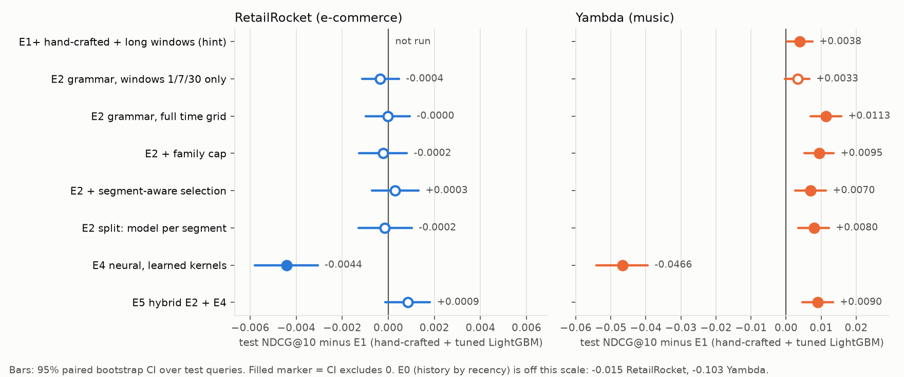
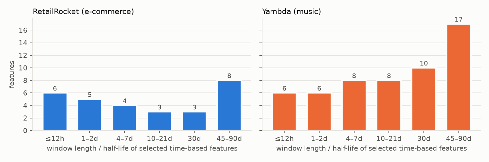
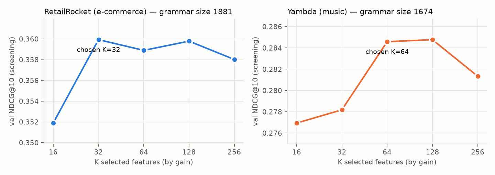

# Автоматическая генерация признаков для ранжирования в RecSys

*Отчёт по заданию. Все числа в этом файле получены скриптами репозитория; таблицы —
`experiments/results/<dataset>/results_table.md` и `slices_table.md`.*

## TL;DR

* Почти любой ручной признак RecSys имеет одну форму: **агрегат по событиям типа S, во временном окне
  или с затуханием, по пути от строки-кандидата к множеству прошлых событий**
  («сколько раз *этот пользователь* *покупал* товары *этой категории* за *7 дней*»). Мы записали эту
  форму как **грамматику**, перечисляем её целиком (1 674–1 881 признак на датасет), считаем каждый
  признак без утечки одним as-of проходом на группу и отбираем подмножество моделью.
  От датасета требуется только схема: какие колонки — атрибуты айтема и какие коды событий есть.
* **Yambda (музыка): автоматический пайплайн значимо обыгрывает настроенный ручной бустинг.**
  Все четыре варианта поиска с полной временной сеткой (и гибрид E5) лучше E1, CI не касается нуля
  (+0.007 … +0.011 NDCG@10). Основной вариант, выбранный заранее объявленным правилом «лучший val»
  (E2-split), даёт **+0.008 [+0.004, +0.012]**; первый и простейший (E2-full) — **+0.011 [+0.007, +0.016]**
  (парный бутстреп по запросам; тест Yambda не использовался ни для одного решения). Большая часть
  выигрыша — автоматический выбор масштаба времени: та же грамматика только с окнами 1/7/30 дней даёт
  +0.003 [−0.000, +0.007], плотная сетка окон и затухания добавляет к ней +0.008 [+0.004, +0.012].
  Поиск выбрал длинную память (30–90 дней), которой нет в шаблоне 1/7/30.
* **RetailRocket (e-commerce): ничья** — все варианты E2 в пределах ±0.0004 от E1 (0.3281), основной
  (E2-split) −0.0002 [−0.0013, +0.0010]. Там
  ранжирование почти целиком определяется повторными просмотрами (NDCG по повторам 0.90 у простой
  истории по давности), а для новых товаров генератор кандидатов покрывает только 10 % целей — признакам
  негде выиграть.
* **Найденное слабое место метода** (одинаковое на обоих датасетах): отбор по общему NDCG набирает
  признаки повторов и пропускает признаки айтема, поэтому на *новых* для пользователя айтемах E2 чуть,
  но значимо хуже ручного набора (−0.002 RetailRocket, −0.004 Yambda). Исправление — отбор по
  сегментам (см. §6): на Yambda (чистая проверка) оно снимает провал на новых треках (−0.0004
  [−0.003, +0.002]) ценой меньшего выигрыша на повторах; отдельные модели на сегмент (E2-split) этого
  не дают. Бесплатного исправления не найдено — найден компромисс.
* Нейросеть, которая **сама учит агрегаты** (обучаемые временные ядра + target attention), в
  CPU-ограничениях проигрывает бустингу (−0.004 RetailRocket, −0.047 Yambda) и в гибриде ничего не
  добавляет; её выученные постоянные времени (≈3 ч, ≈1 день, ≈1 неделя, ≈6 недель) совпадают с тем,
  что инженеры ставят руками.

## 1. Идея

### 1.1 Грамматика признаков

```
Feature = Agg( Filter(events, event_type ∈ S), Window(w) | Decay(h), Key = путь )
Agg   ∈ { cnt  — число событий в [T−w, T)
          dec  — Σ exp(−ln2·(T−t)/h)                 (затухающий счётчик, полураспад h)
          tsl  — часов с последнего события
          age  — часов с первого события }
Key   ∈ { user, item, attr, user×item, user×attr }   attr — каждый категориальный атрибут айтема
S     ∈ { каждый тип события, все неотрицательные, «позитивные» }
производные: conv = A/(B+1) (конверсия между типами событий), share = user×X / user (доля внимания)
w ∈ {1ч … 90д} (16 значений), h ∈ {6ч … 60д} (9 значений)
```

Прямые признаки user×item, косвенные user×category / user×artist, статистики айтема и пользователя,
конверсии и доли — всё это частные случаи одной формы. «Косвенные» признаки — это мета-пути длины 2 в
гетерогенном графе user–item–attribute, так что идея №2 задания (графы) здесь встроена в бустинг, а
не конкурирует с ним. Каждый признак имеет `to_sql()` — это и есть «набор SQL-запросов» идеи №1, только
порождённый перечислением, а не человеком или LLM:

```sql
SELECT SUM(EXP(-LN(2) * (c.cutoff - e.ts) / 5184000))      -- полураспад 60 дней
FROM events e
WHERE e.user = c.user AND e.item = c.item AND e.label IN (1, 2) AND e.ts < c.cutoff
```

### 1.2 Вычисление без утечки, за один проход на группу

Для каждой пары (путь, набор событий) события сортируются по времени, по ключу берутся кумулятивные
счётчики и кумулятивные суммы `exp(t/τ)`; каждая строка-кандидат стыкуется с последним событием строго
до своего `cutoff` as-of джойном. Любое число окон и полураспадов из одной группы стоит одного прохода.
Те же величины в продакшене поддерживаются инкрементально (O(1) на событие для `dec`), так что метод
масштабируется как обычный feature store, а не как «весь датасет в трансформер».

### 1.3 Отбор

1. Посчитать всю грамматику на подвыборке train/val (отбор никогда не видит test).
2. Важность (gain) LightGBM с сильным сэмплированием колонок, 3 сида.
3. Вложенные top-K, K ∈ {16…256}; берём наименьшее K в пределах 0.002 NDCG@10 от лучшего на val.
4. Посчитать выбранное на полных данных; тот же бюджет Optuna (25 trials), что и у ручного бейзлайна;
   итог — среднее 3 сидов.

Варианты: `coarse` (только окна 1/7/30, без затухания — абляция «человеческого» выбора окон),
`div` (не более 2 признаков на семейство путь×события×агрегат), `seg` (§6).

## 2. Протокол (зафиксирован до обучения моделей)

* Запрос = (пользователь, день d), пользователь активен в день d и имеет историю до d.
* Cutoff = начало дня d; все признаки и кандидаты — только из событий `ts < cutoff`.
* Цели = айтемы, с которыми пользователь провзаимодействовал в день d; градуированная релевантность
  (RetailRocket: просмотр 1 / корзина 2 / покупка 3; Yambda: дослушал ≥ 50 % — 1, лайк — 2).
* Разбиение по дням: train | val (отбор признаков, тюнинг, early stopping) | test (смотрим один раз).
  RetailRocket 28/14/14 дней; Yambda 21/7/7.
* Одни и те же строки-кандидаты для всех методов (история пользователя, ко-визиты, популярное в
  категориях пользователя, глобально популярное). Идеальный DCG и recall считаются по **всем** целям,
  включая не попавшие в кандидаты.
* Тесты утечки (`tests/test_leakage.py`): движок == полный перебор `ts < cutoff`; изменение всех
  будущих событий не меняет ни одного признака; намеренно протекающая «канарейка» ловится той же
  проверкой (иначе проверка была бы пустой).
* Метрики: NDCG@10 (главная), Recall@10, Recall@10 по сильным событиям, AUC, logloss. Доверительные
  интервалы — парный бутстреп по запросам (2 000 повторов).

### Данные

| | RetailRocket | Yambda-50M (подвыборка) |
|---|---|---|
| события | 2 756 101 | 935 112 (3 000 пользователей × последние 70 дней) |
| типы событий | view / addtocart / transaction | skip (<50 %) / listen (≥50 %) / like / negative |
| атрибуты айтема | категория, родитель, корень дерева | артист, альбом |
| запросы train/val/test | 12 000 / 4 000 / 15 000 (выборка) | 6 000 / 2 000 / 2 755 |
| recall кандидатов (test) | 0.312 | 0.452 |

Решения по Yambda, принятые до моделей: цели — только **органические** события (41 % целевых событий —
алгоритмические «первые прослушивания», подсунутые рекомендером сервиса; предсказывать их — значит
угадывать чужой рекомендер); размер истории в кандидатах выбран по recall на **val** (0.30 → 0.47).

## 3. Результаты



### 3.1 RetailRocket (тест: 15 000 запросов)

| метод | признаков | val NDCG@10 | **test NDCG@10** | Δ к E1 [95% CI] | Recall@10 | Recall@10 корзина+покупка | AUC |
|---|---|---|---|---|---|---|---|
| E0 популярность 7 д | — | — | 0.0089 | −0.319 | 0.018 | 0.024 | 0.458 |
| E0 история по давности | — | — | 0.3134 | −0.0147 [−0.0166, −0.0128] | 0.332 | 0.288 | 0.854 |
| **E1 ручные + LightGBM** | 38 | 0.3459 | **0.3281** | — | 0.360 | 0.339 | 0.927 |
| E2-coarse (окна 1/7/30) | 34 | 0.3449 | 0.3277 | −0.0004 [−0.0011, +0.0005] | 0.359 | 0.333 | 0.925 |
| E2-full | 35 | 0.3467 | 0.3281 | −0.0000 [−0.0010, +0.0009] | 0.359 | 0.343 | 0.922 |
| E2-div (≤2 на семейство) | 19 | 0.3469 | 0.3279 | −0.0002 [−0.0013, +0.0008] | 0.360 | 0.343 | 0.925 |
| E2-seg (post-hoc, см. §6) | 35 | 0.3470 | 0.3284 | +0.0003 [−0.0007, +0.0013] | 0.360 | 0.330 | 0.926 |
| **E2-split** (основной по val) | 67 | 0.3480 | **0.3279** | −0.0002 [−0.0013, +0.0010] | 0.359 | 0.329 | 0.925 |
| E4 нейросеть | — | 0.3417 | 0.3237 | −0.0044 [−0.0058, −0.0031] | 0.355 | 0.327 | 0.911 |
| E5 гибрид E2-div + E4 | 20 | 0.3473 | 0.3290 | +0.0009 [−0.0001, +0.0018] | 0.361 | 0.344 | 0.927 |

Потолок: recall кандидатов 0.312; доля позитивных строк-кандидатов 1.25 %.

**Почему ничья.** Срез теста (только для отчёта, не для выбора): 26 % целей — айтемы, которые
пользователь уже видел; там простая история по давности даёт NDCG@10 **0.90**, и все модели в пределах
0.90–0.91. 74 % целей — новые айтемы, но генератор кандидатов покрывает лишь **10 %** из них; NDCG@10
на них 0.03–0.04 у всех методов. Разницу ограничивает генератор кандидатов, а не признаки. Ничья на
RetailRocket не означает, что ручные и автоматические признаки равноценны вообще — она означает, что
этот датасет их не различает.


### 3.2 Yambda (тест: 2 755 запросов — все запросы тестовой недели)

| метод | признаков | val NDCG@10 | **test NDCG@10** | Δ к E1 [95% CI] | Recall@10 | Recall@10 лайки | AUC |
|---|---|---|---|---|---|---|---|
| E0 популярность 7 д | — | — | 0.0296 | −0.248 | 0.039 | 0.029 | 0.567 |
| E0 история по давности | — | — | 0.1742 | −0.1030 [−0.1143, −0.0920] | 0.208 | 0.136 | 0.743 |
| **E1 ручные + LightGBM** | 36 | 0.2917 | **0.2772** | — | 0.312 | 0.077 | 0.873 |
| E2-coarse (окна 1/7/30) | 67 | 0.2947 | 0.2805 | +0.0033 [−0.0003, +0.0066] | 0.315 | 0.072 | 0.878 |
| E2-full | 68 | 0.2983 | **0.2885** | **+0.0113 [+0.0069, +0.0157]** | 0.324 | 0.075 | 0.881 |
| E2-div (≤2 на семейство) | 67 | 0.2987 | 0.2867 | +0.0095 [+0.0052, +0.0136] | 0.324 | 0.073 | 0.881 |
| E2-seg | 68 | 0.2976 | 0.2842 | +0.0070 [+0.0025, +0.0114] | 0.321 | 0.069 | 0.881 |
| **E2-split** (основной по val) | 93 | 0.2990 | **0.2853** | **+0.0080 [+0.0035, +0.0122]** | 0.319 | 0.068 | 0.882 |
| E4 нейросеть | — | 0.2390 | 0.2306 | −0.0466 [−0.0541, −0.0395] | 0.259 | 0.090 | 0.793 |
| E5 гибрид E2-div + E4 | 68 | 0.2983 | 0.2862 | +0.0090 [+0.0046, +0.0134] | 0.323 | 0.075 | 0.881 |

Потолок: recall кандидатов 0.452; доля позитивных строк 3.15 %.

Абляция по масштабу времени: **E2-full − E2-coarse = +0.0081 [+0.0041, +0.0122]**. Перебор путей и
агрегатов при окнах 1/7/30 даёт +0.003 (на грани значимости), плотная сетка окон и затухания — ещё +0.008.

**О выборе «основного» варианта.** Правило «лучший val» объявлено до результатов, и мы ему следуем
(E2-split). Но разброс val между четырьмя вариантами E2 с полной сеткой — 0.0014, а их тестов — 0.0043: выбор между ними
по val почти случаен. Поэтому главное утверждение формулируем по всему семейству: **на Yambda все
варианты грамматики с полной временной сеткой значимо лучше ручного набора**, а не «лучший из них
лучше на X».


## 4. Что нашёл поиск



**Масштаб времени зависит от домена, и поиск его находит.** На RetailRocket выбранные временные
признаки распределены по всей шкале от часов до 90 дней, и грубая сетка 1/7/30 работает не хуже
(E2-coarse = E2-full). На Yambda распределение смещено в длинную память: 27 из 55 временных признаков
имеют окно или полураспад 30–90 дней; e-commerce шаблон 1/7/30 этого масштаба не содержит, и именно
здесь плотная сетка даёт значимые +0.008 NDCG@10 (E2-full − E2-coarse, [+0.004, +0.012]).

**Найденная форма, которой не было в ручном наборе.** Самый важный признак RetailRocket —
*доля внимания пользователя к товару*: затухающие просмотры user×item, делённые на затухающие просмотры
пользователя, с полураспадом 12 часов (`share[user×item, views, h=12h]`). В ручном наборе доля была
только для user×category. На Yambda верх списка занимают затухающие прослушивания и лайки user×track
с полураспадом 30–60 дней и доля внимания пользователя на альбоме.

**Чего поиск НЕ выбирает.** На Yambda в 64 выбранных признаках нет ни одного признака трека, артиста или
альбома без пользователя (популярность, конверсия) — gain таких признаков на смеси «повторы + новые»
мал, потому что NDCG почти целиком набирается на повторах. Это и есть причина провала на новых айтемах (§6).



Из ~1 700–1 900 сгенерированных признаков полезно 32 (RetailRocket) и 64 (Yambda); дальше качество
на val не растёт, а с 256 признаками падает. Перечислить грамматику дёшево; дорого — держать в модели
лишнее.


## 5. Нейросеть, которая учит агрегаты сама (E4) и гибрид (E5)

Для пары (u, i, T) модель читает последние L = 50 событий пользователя и для каждого отношения
r ∈ {тот же айтем, тот же атрибут₁, …} и типа события e считает **обучаемый** агрегат
`s_{r,e} = Σ_j 1[r(j,i)]·1[type_j=e]·Σ_m softplus(a_{r,e,m})·exp(−(T−t_j)/τ_m)` с обучаемыми τ_m —
дифференцируемую версию «сколько раз u делал e с похожим на i недавно», где и форма, и длина окна
подбираются градиентом. Рядом — target attention (DIN-подобный) по эмбеддингам истории; популярность
айтема — через банк затухающих счётчиков. Гибрид E5 — выбранные E2-признаки + out-of-fold скор E4 в
LightGBM (фолды — смежные блоки дней train).

| | RetailRocket | Yambda |
|---|---|---|
| E4 test NDCG@10 | 0.3237 (−0.0044 [−0.0058, −0.0031] к E1) | 0.2306 (−0.0466 [−0.0541, −0.0395]) |
| E5 гибрид test NDCG@10 | 0.3290 (+0.0009 [−0.0001, +0.0018]) | 0.2862 (+0.0090 [+0.0046, +0.0134]) — не лучше своей основы E2-div (0.2867) |
| выученные τ (часы), модель второго сида | 3.5 / 28 / 169 / 989 | 2.4 / 16 / 175 / 1 190 |

* Нейросеть сама нашла масштабы «часы / ~сутки / ~неделя / ~6–7 недель» из начальных 3 ч … 30 дней —
  это те же масштабы, что выбирает грамматика и что инженеры ставят руками. Как *генератор признаков*
  она согласуется с E2, но как *модель* проигрывает бустингу.
* На Yambda проигрыш велик и объясним: окно истории — 50 событий, в среднем ≈11 дней, тогда как E2
  показал, что ценная память — 30–90 дней. Это ограничение мы ввели сами ради CPU; ровно в эту стену
  упирается идея «скормить историю трансформеру» (идея №3 задания) — стоимость растёт с длиной истории,
  а затухающие счётчики грамматики хранят ту же информацию за O(1) на ключ.
* Гибрид ничего не добавляет к E2 ни на одном датасете (на RetailRocket +0.0009, CI касается нуля).
* По лайкам Yambda E4 лучше бустингов (Recall@10 0.090 против 0.077 у E1) — единственная метрика, где
  нейросеть впереди; отдельная цель для лайков не строилась.


## 6. Слабое место и его исправление: отбор по сегментам

Срез по новым и повторным айтемам дал одинаковую картину на двух датасетах: E2 выигрывает на
повторах (Yambda +0.017 [+0.011, +0.023]) и слегка, но значимо проигрывает E1 на новых айтемах
(RetailRocket −0.0019 [−0.0032, −0.0006], Yambda −0.0035 [−0.0067, −0.0004]). Причина видна в выбранных
признаках: gain на смеси сегментов определяют повторы, поэтому признаки айтема (популярность, конверсия)
и короткие user×attribute признаки в топ не попадают.

Два исправления; обе версии объявлены до результатов E2 на Yambda (на RetailRocket — после одного
взгляда на тестовый срез, помечено post-hoc):

* **E2-seg** — важность считается отдельно на повторных и на новых строках, два рейтинга чередуются,
  модель одна. Для новых треков поиск сразу поднял *короткие* признаки user×artist (доля внимания на
  артисте с полураспадом 6 ч, полные прослушивания артиста за 3–6 ч): «если пользователь слушает
  артиста сейчас, следующий новый трек — скорее всего того же артиста». Это другой масштаб времени,
  чем у повторов (30–90 дней).
* **E2-split** — две модели (повторы / новые), у каждой свой набор признаков; K и бюджет Optuna
  (13 + 12 trials) выбираются на val.

| Yambda, test NDCG@10 | E1 | E2-full | E2-seg | E2-split |
|---|---|---|---|---|
| новые треки (1 635 запросов) | 0.0303 | 0.0267 (−0.0035\*) | **0.0298 (−0.0004)** | 0.0265 (−0.0037) |
| повторы (2 179 запросов) | 0.389 | **0.406 (+0.017\*)** | 0.400 (+0.011\*) | 0.402 (+0.013\*) |
| всего | 0.277 | **0.289** | 0.284 | 0.285 |

\* — CI разницы с E1 не включает 0.

Итог честный и в части «бесплатного» исправления отрицательный: E2-seg закрывает провал на новых треках,
но отдаёт часть выигрыша на повторах; E2-split провал не закрывает. Модель одного сегмента видит меньше
данных — на 6 000 запросах это, по-видимому, дороже, чем выигрыш от специализации. На RetailRocket оба
варианта дают ту же ничью.


## 7. Ограничения

* CPU-машина (4 ядра, параллельно работали другие процессы) — подвыборки запросов, Yambda — 3 000
  пользователей и 70 дней. Для запросов train в Yambda окна 60–90 дней фактически означают «вся
  доступная история»; вывод — «оптимум за пределами 30 дней», а не «ровно 60».
* Ручной набор для Yambda написан нами по e-commerce шаблону (окна 1/7/30). Опытный инженер музыкального
  сервиса мог бы выбрать окна длиннее; абляция `coarse` как раз отделяет вклад окон от вклада перебора
  путей.
* Нейросеть ограничена 50 последними событиями (≈11 дней в Yambda при ~4.5 событиях в день) — её
  проигрыш на Yambda во многом объясняется этим, и это тот же вопрос масштабируемости, что задан в идее №3.
* Модель учится на «любом взаимодействии»; на лайках (Yambda) ни один бустинг не лучше простой истории —
  отдельная цель для лайков не строилась.
* Генератор кандидатов слабо покрывает новые айтемы (RetailRocket 0.10, Yambda 0.04 recall целей), и это
  потолок для всех методов на срезе новых айтемов.

## 8. Как воспроизвести

```
python -m venv .venv
.venv\Scripts\pip install numpy pandas pyarrow polars duckdb lightgbm catboost optuna scikit-learn scipy matplotlib tqdm pytest
.venv\Scripts\pip install torch --index-url https://download.pytorch.org/whl/cpu   # точные версии: requirements.lock.txt
python src/rr_prep.py && python src/yambda_prep.py   # данные: см. README, раздел Data
python -m pytest tests
sh run_rr_all.sh && sh run_rr_next.sh && sh run_rr_slices.sh
sh run_yambda_all.sh && sh run_seg.sh && sh run_split.sh
python experiments/make_figures.py
```
